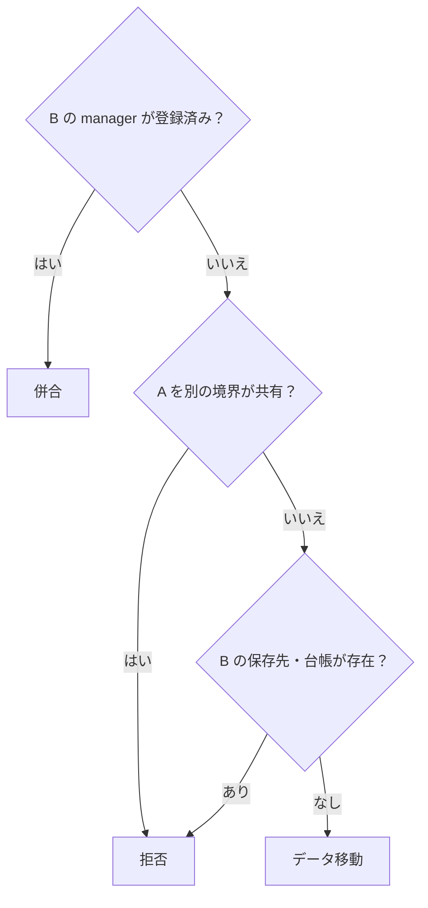

# アーキテクチャ

最終更新: 2026-11-03

vanilla の**いまの構造の地図**。何がどのファイルにあり、どう繋がっているかだけを書く。

- 拡張 API ごとの対応状況は [EXTENSIONS.md](EXTENSIONS.md)

コードは大きなファイルに集中している（`src/ui/treebar.cpp`、`src/gadgets/graphicstableview.cpp`、
`src/ui/treebank.cpp`、`src/view/view.cpp` はどれも 100KB を超える）。ここで当たりを付けてから読むこと。

---

## 全体像

```
main.cpp
  └─ Application                アプリ全体。設定・永続化・グローバル状態
       └─ MainWindow            ウィンドウ。メニューと周辺ウィジェット
            ├─ TreeBar          ツリー型タブのバー
            ├─ ToolBar          ツールバー（アドレスの表示と拡張のボタン）
            ·  （NodePreview     タブに乗せたとき・コマンドバーでタブの行を選んだとき出るサムネイル。アプリで1つの独立ウィンドウ）
            └─ TreeBank         ★中枢。ツリー状態を保持し、View を作る
                 ├─ Node ツリー （ViewNode / LocalNode）
                 ├─ View        表示中のページ（エンジン別の実装）
                 ├─ Gadgets     サムネイル一覧（俯瞰）UI
                 ├─ Receiver    コマンド / URL / 検索の入力欄
                 └─ Notifier    ステータスとリンクのカード
```

---

## ディレクトリ構成

ソースは `src/` の下に**責務ごと**に置く。

| どこ | 何が | 目印 |
|---|---|---|
| [src/core/](../src/core/) | `Application` にも GUI にも依存しない層 | テストが直接呼べる。外の機能は `Hooks` で受け取る |
| [src/app/](../src/app/) | 起動、グローバル状態、プロセスの外との口 | `main.cpp` / `Application` / `Receiver` / `NetworkController` |
| [src/input/](../src/input/) | アクション名の表と JS 公開口 | 割り当ての読み書きは [src/core/inputmap.hpp](../src/core/inputmap.hpp) |
| [src/ui/](../src/ui/) | ウィジェットと描画 | `MainWindow` / `TreeBank` / `TreeBar` / `Theme` |
| [src/view/](../src/view/) | 表示エンジンごとの `View` 実装 | `webengine/`、`edge/`、Native、Local |
| [src/gadgets/](../src/gadgets/) | サムネイル一覧（俯瞰 UI） | `QGraphicsScene` 側 |

- `#include` は**ファイル名だけ**で書く。各ディレクトリがインクルードパスに載っているので、
  ファイルを別のディレクトリへ移しても `#include` は書き換えない
- リポジトリのルートもインクルードパスにある（`#include <VERSION>` のため）
- テストのために切り出したコードは `src/core/` に来る。この層は増えていく
- テストは [tests/](../tests/)、リソースは [resources/](../resources/) と [qrc/](../qrc/)、
  翻訳は [translations/](../translations/)。ビルド成果物はリポジトリの外（[BUILD.md](BUILD.md)）

詳細: D-033、D-034、D-295

---

## 実行時のデータの置き場

根は2つある。アプリ自身の状態は `Application::BaseDirectory()` の下、
エンジンのプロファイルは**エンジンが名前から決める場所**にある。

| 何 | どこ |
|---|---|
| アプリの状態 | `<Base>/data/<MD5(実行ディレクトリ)>/`（`Application::StateDirectory()`） |
| 一時ファイル | `<Base>/temp/`（起動時に空にする） |
| WebEngine のプロファイル | `<AppDataLocation>/QtWebEngine/<MD5(実行パス + "/" + id)>` |
| WebEngine のキャッシュ | `<Base>/data/webenginecache/<同じMD5>` |
| WebView2 のプロファイル | `<Base>/data/edgewebview/EBWebView/WV2Profile_<同じMD5>` |
| QML ビューのプロファイル | `<Base>/data/webengine/<MD5(実行パス + "/quick:" + id)>` |
| Edge の拡張の登録の記録 | `<Base>/data/extension-registry/<SHA256>.json` |

`BaseDirectory()` は**実行ファイルの隣**。ただし `C:/Windows/` と `C:/Program Files/` の下では
`<AppLocalDataLocation>`（`%LOCALAPPDATA%/vanilla/`）になる。つまりインストール版の `data/` は
`%LOCALAPPDATA%` に、持ち運び用では実行ファイルの隣にある。
その場所はアプリ名だけで決まるので、状態はもう一段下の「実行ディレクトリの MD5」に分けて置く。

`StateDirectory()` の中身:

| ファイル / ディレクトリ | 何 |
|---|---|
| `config.json` | 設定 |
| `main_tree.json` / `trash_tree.json` | タブツリーとゴミ箱。プライベートのタブはゴミ箱に入らない（D-581） |
| `cookie.json` | `QNetworkAccessManager` 側のクッキー（エンジンのものではない） |
| `permissions.json` | サイトの許可の表。全ビュー・全プロファイルで 1 つ（`SitePermissions`、D-577） |
| `icondata.json` | ファビコン。プライベートのビューの分は書かない（D-580） |
| `<日時>-*.json` | 上の起動ごとのバックアップ（`Application::CreateBackUpFiles`） |
| `image/` / `history/` | ノードのサムネイルと履歴。プライベートのノードの分は置かない（D-581） |
| `extension-*.json`、`extension-copies/`、`serial-base` | 拡張の状態（「拡張機能」の節） |
| `password.json` | 旧版の残り。読み書きしない |

- Windows では `AppDataLocation` は Roaming、`AppLocalDataLocation` は Local。インストール版の状態は
  Local（`data/`）と Roaming（WebEngine のプロファイル）に分かれる。ローミングプロファイルの環境は未確認
- 古い配置（`<AppDataLocation>/QtWebEngine/<生の id>` など）は今のバイナリが読まないので消してよい
- `<AppLocalDataLocation>/vanilla/WebView2/` は QuickNative のビュー、`cache/qmlcache` などは Qt 自身が作る

詳細: D-044、D-045、D-098〜D-100、D-141、D-258

---

## 保存ファイルの形

保存ファイルはすべて JSON。0.2.2 以前の XML は読まない。

### 設定（`config.json` / `icondata.json`）

キーを入れ子にせず、`"group/subgroup/key"` のフラットなオブジェクトにする。

```json
{
    "application/@AutoSaveInterval": 300000,
    "application/@AllowedCertificates": ["example.com:<leaf SHA-256>"],
    "application/keymap/Ctrl+W": "Close",
    "mainwindow/geometry24387": {"@rect": [341, 192, 1365, 768]},
    "mainwindow/toolbar24387": {"@variant": "AAAADAAAAACA..."}
}
```

- JSON にない型は型名1つのオブジェクトにする（`@url` / `@size` / `@point` / `@rect` / `@color` など）。
  それ以外は `QDataStream` + Base64 の `{"@variant": ...}`
- **型名を間違えても落ちず、その設定が黙って既定値に戻る。** [tests/tst_settingsio.cpp](../tests/tst_settingsio.cpp) が型名を固定している
- 読み書きは [settingsio.cpp](../src/core/settingsio.cpp)（`Application` に依存しない。外の処理は `SettingsIO::Hooks`）
- 読むときは「本体 → `.prev` → バックアップ（新しい順）」の順に試す。書くときは `~name` に書いてから差し替える（`FileExchange`）
- ファイルにあるキーは読み手が無くても保存のたびに書き戻るので、起動時の `Application::LoadGlobalSettings` が
  **アプリの知らないキーを落とす**（`SettingsSchema::IsKnownKey`: 表の行・`UnlistedKeys`・`UnlistedPrefixes`・窓ごとのキー）。
  **表に無いキーを読むコードを足すときは、その 2 つの一覧へ足す。** 足し忘れは `tst_settingsschema` がソースを読んで落とす（D-686）

### セッション（`main_tree.json` / `trash_tree.json`）

`children` の入れ子だけでできている。フォルダは `children` を持ち、タブは `holdview: true` で URL などを持つ。

```json
{
"children": [{
"primary": false, "holdview": false, "folded": true, "title": "folder",
"children": [{
  "primary": true, "holdview": true, "title": "Google",
  "index": 1, "url": "https://www.google.com/", "scrollx": 0, "scrolly": 0, "zoom": 1,
  "history": "{uuid}.dat", "thumb": "{uuid}.jpg"
  }]
}]
}
```

- `index` は保存時にそのノードを表示していたウィンドウの id（0 = どこにも表示していない）
- 読み書きは [treeserializer.cpp](../src/core/treeserializer.cpp)。木を丸ごと `QJsonDocument` に持たず、ストリームで直接読み書きする
- `TreeSerializer` は `ViewNode` 以外に依存しない。ウィンドウの操作は `TreeSerializer::Hooks`（実体は `treebank.cpp` の `TreeHooks()`）

### `cookie.json`

id ごとに、生のクッキー文字列の配列を持つ: `{"root": ["name=value; expires=...; domain=..."], "trash": []}`

### ブックマークの入出力（セッションとは別）

[bookmarkio.cpp](../src/core/bookmarkio.cpp)。形式は XML / HTML のまま。

| 形式 | 読む | 書く |
|---|---|---|
| 内部形式（`<viewnode>` の XML） | ○ | ○ |
| XBEL | ○ | ○ |
| NETSCAPE HTML | ○ | ○ |
| Chrome の `Bookmarks`（Edge / Opera / Vivaldi も同じ形） | ○ | — |
| Firefox の `bookmarks-*.json` | ○ | — |
| IE の `Favorites` ディレクトリ | ○ | — |

URL はパーセントエンコードして書く。`Application::Import` / `Export` にあるのはダイアログと形式の選択だけ。

詳細: D-008、D-011、D-030、D-031、D-136、D-137、D-144、D-298

---

## コアのクラス

### `Application` — [application.cpp](../src/app/application.cpp)

`QApplication` の派生で、アプリのグローバル状態をすべて持つ。

- 設定の読み書き（型は `QMap<QString, QVariant>`。`QSettings` そのものは使っていない）
- 保存先ディレクトリの決定、翻訳、ブックマークの入出力、証明書の判断、アイコンのデータベース
- `BootApplication()` が起動時の初期化をまとめて行う
- 主窓は最初のフレームを描いてから見せる（`MainWindow::ShowWithFirstFrame`。`show()` の間 DWM の cloak で隠す）。PurgeView とユーザー操作の窓は作った時点で見せる。詳細: D-513
- アプリが描くタイトルバー（`application/@EnableCustomTitleBar`、D-664 までの名前はフレームレス窓）は、Windows ではシステムの枠から上（キャプション）だけを外し（`WM_NCCALCSIZE`）、タイトルバーは窓の中の子 `TitleBar`（`src/ui/titlebar.cpp`）にする。影・角丸・スナップ・リサイズの縁はシステムのもので、バーはキャプションとして当たり判定に答える（`MainWindow::FramelessNativeEvent`、規則は `WindowFrameHit`）。最大化中の右上の帯とシェード中の帯は別窓の `TitleBar` で、最大化中の帯は窓の高さを伸び縮みさせて上から滑って出入りする（D-665）。Windows 以外は窓の外のタイトルバーと縁の別窓 8 枚。全画面の縁の 1px は `application/@WindowEdgeColor` の色で塗り（`PaintFullScreenBorder`）、最大化中にクライアントの上に残す 1px はその色を DWM のキャプションの色にする（`ApplyEdgeCaption`）。空ならシステムに任せる。詳細: D-658、D-666
- 窓の中のタイトルバーは、題名の文字をクリックするとその場でアドレスの列になる。URL を見せる欄と、その左右に並べるツールバーのボタン・拡張のバーは `TitleEditRow`（`src/ui/titlebar.cpp`）が持ち、欄の上にはツールバーと同じくコマンドバーが重なって開く。編集はコマンドバーが欄の上にある間だけ続き（`Receiver::AnchorReleased` で終わる）、タイトルバーが隠れると欄ごとコマンドバーも閉じる。詳細: D-659・D-667。最大化中は帯の左の「<」で帯を窓の幅に広げ、題名とアドレス欄を使える。詳細: D-662
- 前の回の窓（設定の `mainwindow/<名前><id>`）は、最初の WebEngine プロファイルと木の読みより前に空の殻として作って見せる。木の読みは同じ id の殻に current を付け、木に無い id の殻は読みのあと消す。殻の間（`Application::IsRestoringWindows()`）は主窓への入力と閉じる操作を受けない。詳細: D-514
- 殻が出るまでの床（Windows）は「DirectWrite の全ファミリーの一覧構築（殻の文字の fallback 照会が要る）→ 殻の生成」で、構築を別スレッドへ出しても、WebEngine の全体設定を殻の後へ回しても縮まない（測って採らず）。詳細: D-516・D-530・D-531

### `TreeBank` — [treebank.cpp](../src/ui/treebank.cpp)

**このアプリの中枢。** ツリーの状態を持ち、ノードと View の対応を管理する。

- ルートは静的メンバ `m_ViewRoot` / `m_TrashRoot`、現在位置は `m_CurrentViewNode`
- 戻る / 進むはビューに任せる（`View::CanGoBack` など）
- ノードから View を作る。既定は `EdgeWebView`（`EDGEWEBVIEW` のあるビルドで WebView2 ランタイムがあるとき）、
  それ以外は `WebEngineView`。ディレクトリの設定で他の実装を選べる
- 木を変えている最中かどうかを `TreeBank::ChangeScope` が数える。外から木を変える処理（拡張など）は
  `MayChangeFromOutside()` を見てから動く
- 木から出ていくノード（ゴミ箱の切り詰め・download carrier）はその場で解放しない。`Discard` で削除箱へ入れ、
  1 turn あとの関門で全部の窓（タブバー・ギャラリー）が手放してから、保存中でなければ解放する（詳細: D-512）
- `DeleteNode(NodeList)` が 2 個以上をゴミ箱へ移したら、`ModelessDialog` で知らせて「ゴミ箱を開く」を出す（詳細: D-550）

詳細: D-160、D-357、D-454

### `Node` 系 — [lightnode.hpp](../src/core/lightnode.hpp)

| クラス | 役割 |
|---|---|
| `ViewNode` | ツリーのノード。`HoldsView()` が真ならタブ、偽ならフォルダ |
| `LocalNode` | ローカルファイル |

`ViewNode` はタブ1つ分のデータ（URL、タイトル、サムネイル、履歴、スクロール位置、ズーム）を自分で持つ。
サムネイルと履歴は保存時に遅れて書き出し（`SaveImageIfNeed()` / `SaveHistoryIfNeed()`）、
必要になったときに読み戻す。履歴の中身は書いたビューの種類で違う（先頭 4 バイトで見分ける）。
ツリーの形は `lightnode.hpp` の冒頭コメントに図がある。

### `View` — [view.hpp](../src/view/view.hpp)

表示エンジンを抽象化するインターフェース。実装は5つ。

| 実装 | 有効条件 | 何 |
|---|---|---|
| `EdgeWebView` | `EDGEWEBVIEW` | `ICoreWebView2` を自前で持つ。Windows x64 の既定。ソースは `src/view/edge/`（一覧は `edgewebview_p.hpp` の冒頭） |
| `WebEngineView` | `WEBENGINEVIEW` | `QWebEngineView`。Windows 以外の既定。ソースは `src/view/webengine/` |
| `QuickWebEngineView` | `WEBENGINEVIEW` | QML の WebEngine（[quickwebengineview6.qml](../src/view/webengine/quickwebengineview6.qml)）。widgets 版の不具合からの逃げ場 |
| `QuickNativeWebView` | `NATIVEWEBVIEW` | Qt WebView。Windows では WebView2 だが、QML の API しか使えない |
| `LocalView` | `LOCALVIEW` | ローカルファイルの閲覧。`GraphicsTableView` と `View` の多重継承 |

- `EdgeWebView` のページは DirectComposition のビジュアルに描かれ、マウスはこちらが `SendMouseInput` で渡す
- [page.hpp](../src/view/page.hpp) の `Page` はエンジンに依らないページの共通処理
- **描画プロセスが落ちたら**、報せて読み直す。`RenderProcessLedger` が回数を数え、10 回目で読み直しをやめる
- ページの右クリックの既定のメニュー（`View::LoadSettings` の RegularMenu）は「新しいタブ」から始まる。
  ブックマークレットの項目は既定から外してある（コマンドからは使える）

詳細: D-024、D-061、D-070、D-166、D-168、D-190、D-249、D-253

### ビューの実装ごとの機能

`QuickNative` と `Edge` はどちらも Windows では WebView2 だが別物。前者は Qt WebView の小さな QML API 越しで、
後者は WebView2 の API を直に使う。

○ = 実機で確認 / △ = 配線はあるが実機未確認 / × = 未対応 / ― = 土台の API が無い / 無効 = 意図して切ってある。
`JS` は注入した JavaScript で実装しているもの。`※` は表の下に注がある。

| 機能 | WebEngine | QuickWebEngine | QuickNative | Edge |
|---|---|---|---|---|
| 描画・サムネイル | ○ | ○ | ○ | ○ |
| タブのアイコン（favicon） | ○ | ○※ | ○※ | ○ |
| 俯瞰（Gadgets）との共存 | ○ | ○ | ○※ | ○※ |
| Notifier / Receiver との共存 | ○ | ○ | ○※ | ○※ |
| プロファイルの分離 | ○ | ○ | ― | ○ |
| Private | ○ | ○ | ― | ○ |
| Cookie の永続 | ○ | ○ | ○ | ○ |
| セッションクッキーの永続 | ○ | ○ | ― | ×※ |
| QNAM の jar への写し | ○ | ○ | ― | ○ |
| セッション履歴の保存復元 | ○ | △※ | △※ | ○※ |
| 戻る / 進む / 巻き戻し | ○ | ○ | ○ | ○ |
| スクロール・ズームの保存復元 | ○ | ○ | ○ | ○ |
| ページ内検索 | ○ | ○ | ○ JS | ○ |
| ページ内検索の件数（n / m） | ○ | ○ | × | ○ |
| 編集（コピー・貼り付けなど） | ○ | ○ | ○ JS | ○ JS※ |
| 書式の編集（15本） | ○ | ○ | △ JS | ○ JS |
| 証明書エラーの続行 | ○ | ○ | ― | ○ |
| 通知の表示 | ○ | ○ | ― | ○ |
| 画面共有の共有先選択 | ○ | ○ | ― | ○※ |
| WebAuthn / パスキー | ○※ | ○※ | ― | ○※ |
| パスワードの保存 | ○※ | ○※ | ― | ○ |
| 権限（クリップボードの読み取り） | ○ | ○ | ― | ○ |
| 権限（local fonts） | ○ | ○ | ― | ○※ |
| 権限の永続 | ○ | ○ | ― | ○ |
| 閲覧データの消去 | ○ | △※ | × | ○ |
| リクエストのブロック / DNT | ○ | ○ | ― | ○※ |
| スペルチェック | △ | △ | ― | ×※ |
| タブの休止 | ○ | ○※ | ― | ○※ |
| POST での遷移 | △※ | × | ― | △※ |
| キャッシュを無視した再読み込み | ○ | ○ | × | ○※ |
| 独自の右クリックメニュー | ○ | ○ | × | ○ |
| 検索エンジンの追加 | ○ | ○ | △ | ○※ |
| ブックマークレットの追加 | ○ | ○ | △ | ○ |
| キーマップ | ○ | ○ | × | ○※ |
| マウスジェスチャ | ○ | ○ | × | ○ |
| 入力欄へのドロップ | ○ | ○ | × | ○ |
| ページ内のキーのフィルタ | ○ | ○ | ― | ○※ |
| パスワードマネージャ | 無効 | 無効 | ― | 無効 |
| 音の検知・ミュート | ○ | ○ | ― | ○ |
| アクセスキー | ○ | ○ | × | ○ |
| ダウンロード | ○ | ○ | × | ○ |
| ディレクトリの設定 | ○ | ○ | ○※ | ○※ |
| UA / AcceptLanguage | ○ | ○ | ○※ | ○ |
| `vanilla://` のページ | ○ | ○ | ―※ | ○ |
| ソース表示（view-source:） | ○ | ○ | ○ | ○ |
| 文字列の文書（`setHtml`） | ○ | ○ | △ | ○ |
| Inspector（ウィンドウ内にも） | ○ | ○ | × | ○ |
| 動画の再生位置 | ○ | ○ | ○ | ○ |
| 印刷 | ○ | ○ | ×※ | ○ |
| ページからの `window.print()` | ○ | ○ | ― | ○ |
| フォントの設定（11件） | ○ | × | × | ×※ |
| 全画面 | ○ | ○ | × | ○ |
| 新しい窓 | ○ | ○ | × | ○ |
| ページから見える `chrome.webview` | ― | ― | ― | 隠す |

注:

- **俯瞰・Notifier / Receiver との共存**: QuickNative と Edge のページはネイティブ窓で、兄弟ウィジェットより上に来る。
  俯瞰は疑似的に重ね、Notifier と Receiver は独立したウィンドウとして出す（`View::ForbidToOverlap()`）
- **タブのアイコン**: どの実装もホスト別のアイコン DB（`Application::RegisterIcon`）に入れ、TreeBar と俯瞰はビュー → DB → 白紙の順に引く。
  QuickWebEngine / QuickNative は `/favicon.ico` を自分で取る（`<link rel=icon>` は見ない）。Edge は `FaviconChanged` / `GetFavicon`（D-533）
- **TreeBar とタブ一覧の描き直し**: 周期では描かない。タブの見た目の入力（題名・アイコン・音声と消音・サムネイル・読み込み・畳み・primary・描画が読む設定）を変える所が
  `TreeBank::TabsLookChanged()` を呼び、各バーと開いているタブ一覧が次の turn に 1 回描く。どのスレッドからも呼べる。入力を足すときは告げる所も足す。
  `LocalView` だけは表示中に周期で描き直す（外さないと決めた。隠れれば止まる）。詳細: D-594、D-595
- **セッションクッキーの永続**: WebView2 に API が無い。Edge では期限の無いクッキーは再起動で消える
- **セッション履歴**: QuickWebEngine は保存だけ。QuickNative と Edge は URL だけ
- **編集**: Edge の Ctrl+C / X / V（Ctrl+Insert、Shift+Delete、Shift+Insert も）はページ自身の編集で、貼り付けはファイルと画像も運ぶ（D-562）。右クリックメニューの「貼り付け」はバックエンドの既定項目に渡す（D-563）。パイプ・ジェスチャ・別のキーに束ねた貼り付けは、アプリ側の文字列を入れる代用
- **WebAuthn / パスキー**: Windows では OS の「Windows セキュリティ」の窓が出て、vanilla のアカウント選択・PIN の窓は出ない。
  vanilla の窓（Windows 以外）は実機未確認。Edge も同じ OS の窓が出る（vanilla からの口は無い。D-196、D-533 追記 3）
- **画面共有の共有先選択**: Edge はバックエンド自身の「共有する内容を選択」が出る（vanilla から選ばせる口は無い。D-196、D-533 追記 3）
- **スペルチェック**: Edge は API が無く、誤りの下線もメニューの候補も出ない（D-533 追記 3）。WebEngine / QuickWebEngine は辞書が無い環境では下線が出ない（D-275）
- **POST での遷移**: 3 実装に配線はあるが、vanilla の中に POST で読む経路が無い（検索エンジンの 3 つ目の値は既定の印で、POST ではない）。実機では確かめようがない（D-533 追記 4）
- **文字列の文書**: `ViewSource` の子で `ApplySource` を使うと、親に `setHtml` で描き直す。WebEngine / QuickWebEngine はこの経路で確認（D-533 追記 4）
- **パスワードの保存**: WebEngine と QuickWebEngine はメインフレームと iframe のフォームで（iframe はその枠の origin で保存し、その枠にだけ入れる。D-610）、保存先は OS の保管庫（QtKeychain）。入れるのは、欄のクリックか ↓ キーで出る一覧でアカウントを選んだときだけ（一覧はフォーカスを取らず、打った文字は欄へ入って一覧を前方一致で絞る。絞りはページのアプリの world でして、欄の値はアプリへ出ない。↑↓ Enter Esc Tab は一覧が出ている間だけアプリが取る。D-611）。
  保存したものは設定画面の「保存したパスワード」で一覧し、1 件ずつか全部を消す（Edge の分は一覧に出ず、全部消すときに消える）
- **サイトの許可**: 3 実装（Edge・WebEngine・QuickWebEngine）とも `SitePermissions` の表で答え、表に無いときだけ聞く。
  エンジンのプロファイルは表の写しで、プロファイルを作るたびと表が変わるたびに揃える（古い記録はそこで消える）。
  Edge は写しが済むまで最初のページを開かない。QuickNative は表を使わない。設定画面の「サイトのアクセス許可」で一覧・切り替え・削除（D-577）。拡張機能のページも表に残し、一覧には名前を出す（D-650）
- **local fonts**: Edge の `file://` のページでは、再読み込みで許可が「確認する」に戻る
- **閲覧データの消去**: QuickWebEngine は訪問済みリンクだけ消せない（Qt に API が無い）
- **ブロック / DNT**: Edge は iframe の文書を見逃す
- **タブの休止**: Edge は凍結（Frozen）だけで、破棄（Discarded）は無い。QuickWebEngine は凍結をテストで確かめ、破棄は未確認（隠れたビューをエンジンにも隠すまで、どちらも効いていなかった: D-587）
- **キャッシュを無視した再読み込み**: Edge はヘッダだけで、次の1回だけ
- **キーマップ・ページ内のキー**: Edge は許可リスト制で、トップ文書だけ
- **検索エンジンの追加**: 本体は `Page::AddSearchEngineAt` で 4 実装共通。Edge の右クリックの位置は本物のカーソルから取るので、
  合成入力の検証ではフォームを探せない。人手では確認済み（2026-10-11、D-533 追記 5）
- **ディレクトリの設定・UA**: QuickNative は一部（UA は効く）。Edge は JS とエラーページの設定だけ
- **`vanilla://`**: QuickNative では開けず、代わりに WebEngine が開く
- **印刷**: QuickNative は PDF の書き出しだけ
- **ダウンロード**: どの実装も履歴（`DownloadHistory`、新しい 500 件）に記録し、ツールバーのボタンの吹き出し（`DownloadPanel`。ツールバーが無いときは窓の右上）と設定画面の「ダウンロード」がそれを見せる。Notifier には出さない。ボタンは進行中・終わってから 1 分・吹き出しが開いている間だけ出す（詳細: D-506、D-519）。
- **フォームの送信**: メインフレームの multipart の送信が 2 秒続くと、同じ吹き出しの先頭に「送信中」の行と止めるボタンを出す（`RunningUploads`。WebEngineView と Edge。保存しない）。進捗は出ない。XHR と fetch は対象外（詳細: D-630、D-631）。
  Edge のダウンロードはそのビューの `CoreWebView2` が運び、閉じると何も聞こえなくなるので、ダウンロード中のタブを閉じてもビューは隠したまま終端まで生かし（`EdgeDownloadCarriers`）、終わってから消す。閉じたタブはたずねない（詳細: D-279、D-564）
- **フォントの設定**: Edge には設定そのものが無い
- QuickNative の × の多くは Qt WebView の QML API が小さいため。`runJavaScript` はあるので、JS で書けるものは動く。
  ページの上の入力はネイティブ窓が先に取るので、API があっても届かない

詳細: 各行の D 番号は D-070〜D-091、D-160〜D-202、D-245〜D-279、D-302、D-332、D-339。
Edge の × が「API が無い」ことは D-196、QuickWebEngine の残る × は D-200 / D-201。

### `Gadgets` / `GraphicsTableView` — [src/gadgets/](../src/gadgets/)

タブとディレクトリを一覧して編集する UI（俯瞰）。`QGraphicsScene` の上に作る。

- `GraphicsTableView` が一覧の本体。`DisplayType` で ViewTree / TrashTree / LocalFolderTree などを切り替える
- 表示の種類は「現在のディレクトリ」「配下すべて（全展開）」「配下すべて（展開可）」の3つ（D-497 追記 4）
- 個々の項目は `AbstractNodeItem` / `Thumbnail` / `NodeTitle`
- ノードのメニュー（`Gadgets::CreateNodeMenu`）はどこで開いても同じ並び（開く・ノード・作る・消す/戻す・行き先と見せ方・中止）。ゴミ箱は復元が先頭で、作るが無く、消すは「完全に削除」（D-551、D-552、D-589）。ゴミ箱の一覧ではサムネイルの複製ボタンが復元ボタン、閉じるボタン・削除のコマンドは確認のあと完全に削除（D-572、D-589。スタートページの履歴と同じ `TreeBank::DiscardFromTrashAsked`）
- 描画は `GadgetsStyle`。`PlainStyle`（Flat と同じ格子を単色の面に、既定。D-652）、`FlatStyle`（カードの格子）、`GlassStyle`（暗い半透明）の3つ
- 上端に固定のバー（`TableHeader`）。上へ・ゴミ箱のボタン、パンくず、絞り込み欄（`HeaderFilter`）、タブ一覧とゴミ箱では右端に閉じるボタン（`CloseTableButton`）が並び、カードはその下から始まる（D-602、D-603）
- ノードを並べている間、背景は（Plain は半透明の窓のときだけ）一覧の current のノードのページを絵にしてぼかしたもの（どのバックエンドでも止まった絵）。AccessKey の間と設定でオフのときは従来どおり（D-590）
- 表示中のタブは淡い背景とアクセントの線で示す。折りたたみの開閉は 200ms で補間する

詳細: D-300〜D-305、D-308、D-338、D-592（開くときの描く順）、D-602（バー）、D-603（閉じるボタン）、D-652（Plain）

### 入力とアクション

| ファイル | 役割 |
|---|---|
| [actionmapper.hpp](../src/input/actionmapper.hpp) | アクション名の一覧。編集アクションには QML 側の関数名（先頭小文字）も並べる |
| [actiontext.hpp](../src/core/actiontext.hpp) | アクションの表示名（訳の文脈 `ActionText` の 1 表）。メニュー・キーの設定・コマンドバー・入力欄のメニューが引く。4 つのクラスの `Action()` は一覧のマクロで接続だけを書く（D-678） |
| [keymap.hpp](../src/input/keymap.hpp) | キー → アクション名の既定。修飾キーの無い単独キーは設定 `webview/@EnableSingleKeyShortcut`（既定オフ）のときだけ効く |
| [mousemap.hpp](../src/input/mousemap.hpp) | マウスジェスチャ → アクション名の既定 |
| [commandmap.hpp](../src/core/commandmap.hpp) | コマンドの綴り → アクション名。綴りの揺れはここにだけある |
| [receiver.hpp](../src/app/receiver.hpp) | 入力欄のカード。Command / Query / UrlEdit / Search の4モード。中央に浮かび、ページ内検索（`search <語>` を含む）は右上。コマンドバーの候補はコマンド（検索エンジンとブックマークレットの名前を含む）・タブ・ゴミ箱・設定・Web のソース別で、行の操作は Tab か右クリックの一覧（D-622、D-625、D-633）。タブとゴミ箱の行を選ぶとカードの脇にタブのプレビュー（D-692） |
| [searchsuggest.hpp](../src/core/searchsuggest.hpp) | 検索の候補を問い合わせる URL と答えの読み取り（Google / Bing / DuckDuckGo。D-622） |

アクション名と入力の綴りの2系統は互換性のために残る。綴りの表の全体は `tst_commandmap` が固定する。ページから叩く JavaScript の API は無い。

詳細: D-054、D-123、D-295、D-430、D-540、D-622、D-625、D-633、D-636

### その他

| クラス | 役割 |
|---|---|
| `NetworkController` — [networkcontroller.hpp](../src/app/networkcontroller.hpp) | `NetworkAccessManager` の生成、Cookie、プロキシ、認証 |
| `AutoSaver` — [saver.hpp](../src/app/saver.hpp) | 自動保存。GUI のスレッドで値を写し、別スレッドで順に書く |
| `Transmitter` — [transmitter.hpp](../src/app/transmitter.hpp) | 二重起動のとき、既にあるプロセスへ引数を渡して終了する |
| `UserAgent` — [useragent.hpp](../src/core/useragent.hpp) | 名乗るブラウザの表と、その設定の読み書き |
| `DownloadName` — [downloadname.hpp](../src/core/downloadname.hpp) | ダウンロード先のファイル名を作る規則 |
| `WindowLedger` — [windowledger.hpp](../src/core/windowledger.hpp) | どのウィンドウがあり、今どれかを持つ表 |
| `Notifier` — [notifier.hpp](../src/ui/notifier.hpp) | ステータスとリンクのカード。内容があるときだけ出る（D-621。ダウンロードは D-506 から吹き出しへ。行は D-630 で撤去） |
| `DownloadBar` / `DownloadPanel` — [downloadbar.hpp](../src/ui/downloadbar.hpp) | ツールバーのダウンロードのボタンと、その吹き出し |
| `RunningUploads` — [runninguploads.hpp](../src/app/runninguploads.hpp) | 送信中のフォーム。吹き出しの行の元で、保存しない |
| `Dialog` — [dialog.hpp](../src/ui/dialog.hpp) | 自前で描くダイアログ。モードレスは窓の右に積む別窓 |
| `EditMenu` — [editmenu.hpp](../src/ui/editmenu.hpp) | 入力欄（アドレス欄・コマンドバー・ダイアログ）のコンテキストメニュー。ページの文字メニューと同じ項目と言葉（D-522） |
| `MenuKeys` — [menukeys.hpp](../src/ui/menukeys.hpp) | メニューの右に出すキー。開いた場所で押せば効くものを項目ごとに 1 つ（D-548） |
| `MiniMap` — [minimap.hpp](../src/ui/minimap.hpp) | ページの脇の帯。注入した JS が集めた要素の矩形を図にする。文書が動かず中の要素がスクロールするページはその要素を描く（D-485）。ページ内検索の語の一致を橙で重ねる（D-676）。窓ごとに `ToggleMiniMap`（「表示」メニュー）で作り・消し、`mainwindow/minimap<n>` に残す（既定オフ。D-689） |

`Receiver` のローカルサーバ（パイプのコマンドの受け口）は同じユーザーだけが接続でき、1フレームは 1 MiB まで。

詳細: D-056、D-058、D-145、D-209〜D-238、D-264、D-279、D-287〜D-293、D-309

---

## 設定

設定は `group/subgroup/key` → 値の平らな表（`Application` の `Settings`）で、`config.json` に書かれる。
読む側は `s.value("application/@EnableAutoSave", true)` の形。

### 設定画面（`vanilla://settings`）

設定画面はタブで開く**ページ**。

| 何 | どこ |
|---|---|
| スキームのハンドラ（ページと JSON API） | [settingspage.hpp](../src/app/settingspage.hpp) |
| 何を描くかの表（型・ラベル・分類・既定値・選択肢） | [settingsschema.cpp](../src/core/settingsschema.cpp) |
| 選択肢の表示名（Choice の値 → 画面の言葉） | 同じファイルの `ChoiceLabels()`。無い選択肢は値の綴りのまま出る |
| キー・マウス・ジェスチャの表 | [inputmapschema.hpp](../src/core/inputmapschema.hpp) |
| ページ本体 | [resources/settings/](../resources/settings/)。文書には `/api/schema` の JSON とシートとスクリプトが埋め込まれて 1 往復で届く（`WithEmbeddedSchema` / `WithInlineResources`） |

**設定を1つ画面に出すには、`settingsschema.cpp` の表に1行足すだけ。** HTML も JS も触らない。
行は表の順に出るので、同じ話題の行の隣に足す。分類は「読者がどこを探すか」で決める（ミニマップは主窓の帯なので「外観」、
ジェスチャの on/off は「キーとマウス」、ダウンロード先は「ダウンロード」。これらの節は自分の表や履歴の上に行を出す）。
長い節は `GROUPS`（先頭の行のキー → 小見出し）で群に分け、ページが `h3` を描く。
ラベルの下の説明（`hint`）は、ラベルと選択肢の名前から分からない事実だけを 1〜2 文で書く。言い直し・選択肢の解説・操作のコツは置かない（D-561）。

- **既定値は、そのキーを読むコードが `s.value` に渡す値と同じにする。** `tst_settingsschema` がソースと照合する
- 書けるのは表にあるキーだけ。型と選択肢も検査する。よそのページからは API に届かない
- 開きかたは `settings` コマンド、メニューの「設定」、拡張の一覧の「拡張機能を管理」、アドレスバーへの入力。
  前の3つは `TreeBank::OpenSettings(category)` で同じ1つのタブを使う。タブのビューは、ディレクトリが指す種類
  （`ViewKindFor`）と同じなら作り直さず前面に出すだけ（D-537）
- 表示中のカテゴリは URL のフラグメント（`vanilla://settings/#network`）で持つ
- **隠し設定**: 普段は誰でも押せる箱にしない設定（ページが普段止められていることの抜け道・具合の悪いときに切るエンジンの切り替え・総称フォント・名乗る UA のテンプレート）は、分類 `hidden` の行にする。ページは題を 3 回クリックするまでその分類を一覧・検索・フラグメントから外す。開いた状態は保存しない。エンジンの属性とフォントは WebEngine のビューだけが読む（詳細: D-685）
- 別の設定しだいで使われない行は、表の `appliesWhen`（`"key=value|…"`、どれか 1 つが成り立てば使われる）で宣言する。
  ページがその行を灰色にして入力を拒み、どの設定のせいかを下に書く。条件は hint に重ねて書かない（D-571）
- `needsRestart` の行の値が変わると、`ModelessDialog` のカードが「再起動」を勧める（自動では閉じない）。
  再起動は `Application::Restart` → 終了の段を通ったあと `_main` が同じ exe を `--restart-after=<pid>` 付きで起動し、
  新しいプロセスは旧プロセスの終了を待ってから既存インスタンスを探す（D-571）
- `vanilla://` のページは、ディレクトリが QuickNative を指していても `WebEngineView` が描く
- 型は Bool・Int・Text・Choice・Directory・TextList・Color。Color は `#rrggbb` か空（システムの色）で、ページは見本と「色の選択…」（`/api/pick-color` がアプリの `QColorDialog` を開く）を出す（D-666）
- 検索中は、描き終えたページの文字のうち検索語に当たる所を `<mark>`（アクセント色の太字）で囲む（`markFound`。選択肢と入力欄の中は除く。D-582）

**画面の文字列**: ページは `QTranslator` に触れないので、文字列は全部訳された状態で C++ から届ける
（ラベルは表の `QT_TRANSLATE_NOOP("SettingsSchema", ...)`、ページ自身の言葉は `SettingsSchema::PageStrings()`）。
**`QT_TRANSLATE_NOOP` をマクロで短くしないこと。** lupdate はマクロを展開せず、拾われなかった文字列は黙って英語のままになる。

詳細: D-020、D-218、D-431、D-455、D-462、D-475、D-537、D-549、D-561、D-571、D-575、D-582、D-666

### スタートページ（`vanilla://start`）

- 新しいタブと初回起動で開く。名前で開く `about:blank` はそのまま
- 検索欄（検索エンジンを選べる）、主窓のアクションのボタン、最後に見た順のタブのカード（サムネイル・題名 2 行まで・上のディレクトリの並び・ホスト。幅に合わせた列数 × 2 行。自前のページは出さない）。カードの × ・中クリック・Delete キーでそのタブをゴミ箱へ。検索欄はタブの検索も兼ねる（自前のページも見つかる。ゴミ箱は探さない）
- 「もっと見る」でカードの枠が**タブ履歴**に替わる: 開いているタブとゴミ箱のタブを最後に見た順（同じ秒は serial 順）に、日付の見出しで区切った行。50 行ずつ。生きている行は × でその場で閉じる（行は動かない）。閉じた行はチェックボックスと復元の矢印つきで、押すと start のタブの隣（新規タブと同じ位置の規則、`TreeBank::RestoreBeside`）へ戻して current にする。日付の見出しのチェックはその日の読み込み済みの閉じた行をまとめて選び、「削除」ボタンでゴミ箱から完全に消す（取り消せないので、アプリのモーダルで確認してから）（`TreeBank::DiscardFromTrash`。切り詰めと同じ手順）
- 検索中は、題名と住所の検索語に当たる所をアクセント色の太字にする。住所はホストだけを出し、題名にもホストにも無い語があるときだけパスまで出す（その語がスキームにしか無ければスキームから）。照合はアプリ（`CollectTabs`）が題名と `QUrl::toString()` で行い、ページはその文字列を `address` で受け取る（D-582）
- タブ・新規ウィンドウ・設定を開いて current が移ると、start のタブは外れる（履歴があればゴミ箱へ、無ければゴミ箱に入れない）
- 半透明の窓では、start のあいだだけ下地を透かして acrylic を見せる（設定画面も同じ。`VanillaPage::IsTranslucentPage`、D-542 追記 12）

詳細: D-558、D-527 追記 1、D-572、D-573、D-582

### ディレクトリの設定（設定画面の「ディレクトリ」）

ディレクトリノードの名前は `名前;トークン;トークン` で、`;` の後ろが**そのディレクトリの下に効く設定**になる
（`ID` / `Private` / `!Javascript` / `RightGesture` / `Encoding EUC-JP` など）。`;` の後ろは画面に出さない。

継承の規則:

| どこ | どちらが勝つか |
|---|---|
| ディレクトリの間 | 近いほう。何も言っていない設定は、さらに上から降りてくる |
| 同じ名前の中の `X;!X` | 否定 |

- 上で設定を変えると、下でそれを打ち消す語を外す（`LetDescendantsFollow`）。上の変更は下まで行き渡る
- `ID` だけは継承でなく**ネットワークプロファイルの境目の印**で、中にもう1つ境目を作れる
- `Private` はビューごとに、自分のノードの継承した言葉で決める
- 自動読み込みは既定でしない。`!noload` を書いたディレクトリだけが起動時に裏で読み込む（`application/@EnableAutoLoad` もオンのとき。オフの間はディレクトリの行を選べない: D-586）。タイマーの 1 回で歩くのは 1,000 ノードまで（詳細: D-510）
- 読む側はどれも `DirectoryPage::StateIn` に訊く（`1` / `0` / `-1`）

設定を書く口は2つで、実装は [directorypage.hpp](../src/app/directorypage.hpp) の1つ。

| 口 | 何 |
|---|---|
| 設定画面の「ディレクトリ」 | ディレクトリの木全体から 1 つを選び、そのディレクトリと祖先の設定を並べる。開くと、メニューや俯瞰から頼んだディレクトリか、設定のタブがいるディレクトリ。`vanilla://directory` は置き換えで ここへ来る |
| ノードの右クリック | TreeBar と俯瞰の「ディレクトリの設定」サブメニュー |

- 編集はすべてリネーム（`TreeBank::ReconfigureDirectory`）を通るので、ネットワークプロファイルの付け替えも同じ経路で働く
- ノードのリネームの欄は名前だけを見せ、元のトークンを付け直す。`;` は打てない
- ルートも編集できる（`application/@RootName` に残る）。ゴミ箱は編集できない
- 一覧で選ぶと、一覧内のスクロール位置を描き直しの前後で保つ（D-618）
- 分解・合成・継承は純粋な関数で、`tst_directorypage` が固定する

**名前を変えるときのプロファイル**

ID ディレクトリと根で、空間の境界を保ったまま `A` → `B` と名前を変えると、**データ移動・併合・拒否**のいずれかになる。「併合」は B が既にある空間のときで、プロファイル全体の統合ではない（WebEngine・Quick のサイトのデータは読み出せないので運べない）。

**1. 名前変更の判定**

別の移動が進行していない場合は、次の順で決める。



- **登録済み**: 名前 → manager の表から B の manager を引けること。起動時の `cookie.json` の読み込みでも登録されるので、表示中のタブの有無では決まらない。
- **共有**: ほかの ID ディレクトリや根も A を空間名にしていること（ゴミ箱内も含む）。子ディレクトリが A を継承するだけなら共有とは数えない。
- **保存先・台帳**: 移動先候補のエンジン保存先・キャッシュと拡張の台帳。B が未登録でも、これらがディスクに残っていれば拒否する。

B が登録済みなら、移動先の競合判定を通らず、併合へ進む。併合では A の共有を見て、共有されていれば A を手放さない。

**2. データへの影響**

| 対象 | データ移動 | 併合 | 拒否 |
|---|---|---|---|
| QNAM の保存対象 Cookie | B へ引き継ぐ | B の jar に合流 | 変更なし |
| Edge の Cookie | 保存先ごと移動 | 永続 Cookie のうち、B に同じ名前・domain・path が無いものだけ B へ足す | 変更なし |
| エンジン保存先・キャッシュ | B へ移動 | 移動しない（A に残す） | 変更なし |
| 拡張の状態・台帳 | B へ移動 | 移動しない | 変更なし |
| 保存パスワード | B へ移動 | B へ移す（B にあるものを残す。A が共有なら移さない） | 変更なし |
| A のプロファイルを使う既存ビュー | 全窓で閉じ、各窓の current だけ再生成 | 同じ（A が共有ならこのディレクトリの下だけ）。B の Edge のビューも閉じて開き直す | 変更なし |
| A の manager | 破棄し、保存対象 Cookie を持つ B の manager を生成 | 破棄（A が共有なら残す） | 変更なし |
| 名前変更 | 成立（一部の移動失敗時も） | 成立 | 題名を元に戻す |

データ移動の欄は成功した項目の扱い。一部だけ移動に失敗することがあり、全項目をまとめて成功・失敗にする原子的な操作ではない。

**3. 制約と未保証事項**

- **対象外**: 普通のディレクトリの名前だけを変えても、継承元の空間は変わらない。ID の付け外しは別の経路で、ID を外すと、A を共有する境界が無ければ庫を閉じて手放し（データは残す）、下のタブを親の空間で開き直す。ID を付けると、同名の空間が登録済みならそこへ入り、無ければ作る。どちらも、まだ閉じきっていない保存先を開くときは拒否する（D-619）。
- **実行中の制約**: データ移動はダウンロード中・別の移動中に拒否し、移動中は全窓の入力を止める。別の移動で保護中の A/B の境界を変更する要求は、上の判定より先に拒否する。
- **移動の限界**: 移せなかった保存先・台帳は元のパスを、パスワードは失敗件数を報告し、成功分を戻すことなく処理を終える。新名では失敗分のデータを引き継がない。セッション Cookie・sessionStorage・ページ内の状態は失われうる。
- **併合の限界**: WebEngine・Quick のログインは B へ運べない（報告する）。Edge の Cookie は、そのセッションで Edge の環境ができていないと運べない（報告する）。これがこのアプリがバックエンドの Cookie 庫へ書く唯一の場所（D-259 L1 の例外、D-619）。
- **使っていないプロファイルの削除**: 設定画面の「プロファイル」が、ディスクの保存先を空間ごとに一覧にし、ツリーで使っておらずタブでも開いていない行だけを消す。名前の当たらない行は、別のインストールやビルドのものかもしれないと注意書きを出す（共有の保存先があるため）。詳細: D-620。
- **WebView2 の「最後に使ったプロファイル」**: Edge のビューが残らない rename では、ブラウザのプロセスが終わるのを待ってから移し、`Local State` の `last_used` が無いプロファイルを指していたら外す（次に起動したブラウザが旧い場所に空のプロファイルを作り直さないように）。環境を作る前とブラウザが終わるたびにも同じことをする（D-617 追記 1）。

詳細: D-047、D-048、D-078、D-116〜D-122、D-310、D-311、D-428、D-617、D-619

---

## アドレスバーに打った文字

判定は2段ある。**スキームを足すときは両方を見ること。**

| 関数 | 何を決めるか |
|---|---|
| [page.cpp](../src/view/page.cpp) の `ExtractUrlsFromText` | URL か検索語か。載っていないスキームは黙って検索される |
| [toolbar.cpp](../src/ui/toolbar.cpp) の `IsUrlToLoadInPlace` | 今のタブで開くか、`Receiver` を通して新しいタブで開くか |

`tst_inputmapping` の `tellsAUrlFromSomethingToSearchFor` が、どちらに転ぶべきかを固定している。

アドレスバーの候補は今のタブと周辺（上の階層の URL・同じ階層のタブ・打った URL の履歴・ページへの動作）だけで、
アプリ全体と窓の動作はコマンドバーの候補に任せる（D-624）。コマンドバーの Web のタブも、今のタブの上の階層を
「アドレスを開く」か「Web を検索」の下に出す（D-667）。

ツールバーとタイトルバーの欄は URL を見せるだけで、押すとコマンドバー（`Receiver::OpenAtField`）がその欄に重なって開く。
Web のタブ・今の URL を全選択・行は選ばない。行を選ばない Enter と「アドレスを開く」の行は今のタブで開く。
欄に重なっている間の Receiver は主窓に所有された窓で、閉じたあと木の子へ戻す。入力行は欄と同じ高さ・同じ見た目で欄に重なり、欄が下にあるとき（下のツールバー）は入力行がカードの下端、ソースのタブがそのすぐ上に来て、候補はさらに上へ伸びる。タイトルバーの列のボタンや拡張を押すとコマンドバーは閉じ、列は URL を見せる欄とともに残る（欄を押せばまた開く）。
欄の左にはサイト情報のボタン（`SiteButton`）があり、吹き出し（`SiteInfoPanel`、`Qt::Popup`）にホスト・接続（URL と保存した証明書の例外から言えることだけ）・保存した許可（`SitePermissions`、選択で書き換え）・Cookie の件数とサイトデータの削除・サイトの設定を出す。Cookie とサイトデータは、ビューが出す DevTools プロトコルの口（`View::OpenSiteDataLink` が返す `SiteDataLink`。Edge は `CallDevToolsProtocolMethod`、WebEngine は利用者のインスペクターか、吹き出しの間だけつなぐ隠れた devtools ページ。Quick は同じ形で、隠れた QML のビューを `devToolsView` に渡す。ネイティブのビューは出さない）を通し、`SiteCookies` が数えて 2 回押すと消す。詳細: D-668、D-674
詳細: D-667

---

## ユーザーエージェント

既定は**エンジン自身の UA**。別のブラウザを名乗るのは、ディレクトリに `;useragent chrome` のように書いたときだけ。

- 名乗れるのは Edge・Firefox・OPR・Safari・Chrome・Sleipnir・Vivaldi・Gecko と自分で書く Custom。表は [useragent.cpp](../src/core/useragent.cpp)。
  名前でない値は、`product/version` を含む（UA らしい）ときだけそのまま送る。外した IE などの名前や打ち間違いはエンジン自身の UA のまま（D-683、D-684）
- `NetworkAccessManager::SetUserAgent` が `%SYSTEM%`（Chrome が固定した `Windows NT 10.0; Win64; x64` / `X11; Linux x86_64`）と
  `%CHROMIUM%`（積んでいる Chromium のメジャー版）を埋める
- **Chromium の版を直書きしないこと。** 版は `qWebEngineChromiumVersion()` から取る
- Google は「Chrome を名乗る Chrome でないブラウザ」のログインを拒むので、偽装は常用しない

詳細: D-058、D-101、D-102、D-683、D-684

---

## エンジンの起動時の設定

### Chromium のスイッチ

`chrome://flags` は無い（Chrome のブラウザ層の機能のため）。代わりに設定 `application/@ChromiumFlags`
（`--` で始まる語を空白か改行で区切る）を、`Application::ApplyChromiumFlags()` が環境変数 `QTWEBENGINE_CHROMIUM_FLAGS` へ、
Edge には `edgeenvironment.cpp` が `AdditionalBrowserArguments` として渡す。

- 反映は次の起動から。元から環境変数があれば、その後ろに足す
- エンジンが受け付けないスイッチを書くと起動しなくなりうる。戻すには `config.json` を手で直す
- リモートデバッグは通常は開かない。検証のときだけ `QTWEBENGINE_REMOTE_DEBUGGING` を外から設定する

### 描画 API

設定 `application/@GraphicsApi`（既定は Windows で `OpenGL`、他は `Auto`。D-342 追記 2）を `Application::ApplyGraphicsApi()` が `QQuickWindow::setGraphicsApi` に渡す。
WebEngine のビューは中身が QQuickWindow なので、これが Web ビューの描画 API になる。

- 最初の QQuickWindow より前、`BootApplication` が設定を読んだ直後に呼ぶ
- 環境変数 `QSG_RHI_BACKEND` があれば設定は無視する。その OS で動かない API は `Auto` 扱い
- 主窓を最初から RHI にするのは `application/@EnableMainWindowRhi`（既定オフ）のときだけ

詳細: D-142、D-340〜D-343、D-453、D-458、D-463

---

## 外部コマンド（「別のブラウザで開く」）

個別のブラウザの決め打ちは無い。

| 何 | どこ |
|---|---|
| 既定のブラウザで開く | `Application::OpenUrlWithDefaultBrowser()`（`QDesktopServices::openUrl()`） |
| ユーザー定義のコマンド | 設定 `application/@ExternalCommands`。1行が `name = コマンドライン`、URL は `%u` の位置 |

ユーザー定義のコマンドは個数が変わるのでアクションにしていない。メニューを組むところで `QAction` を作り、
コマンド名を `EXTERNAL_COMMAND_PROPERTY` に載せて1つのスロットへ流す。そのメニューを組むのは
`View::AddExternalCommandActions`、`Gadgets::CreateNodeMenu`、TreeBar の `NodeItem`。**経路を足すならこの形に倣う。**

詳細: D-004、D-021

---

## 色とアイコン

描画に使う色は **[theme.cpp](../src/ui/theme.cpp) の1つの表にしかない**。呼び出し側は用途の名前で引く。

```cpp
painter->setBrush(Theme::Brush(Theme::BarBackground));
painter->setPen(Theme::Pen(Theme::GlassText));
```

- **他の場所に色のリテラルを書かないこと。** 名前は色ではなく用途（`BarButtonPressed`）
- 関数ローカルの `static const QBrush` に入れないこと（実行中に配色を変えられなくなる）
- 名前を足したら Light と Dark の両方の表と `tst_theme` に足す
- 配色は `application/@ColorScheme`（`Auto` / `Light` / `Dark`）。`Auto` はデスクトップに追従する
- Windows のウィンドウメニュー（タイトルバーの右クリック・Alt+Space）はシステムが描くので、配色は uxtheme の
  `SetPreferredAppMode` で合わせる（`SystemMenu::ApplyScheme`、`UpdateAllWidgets` から）。項目にはアプリケーション
  メニュー（`TreeBank::GlobalContextMenu`）を開くたびに写す（`MainWindow::nativeEvent`）。詳細: D-547
- 色を保持するもの（TreeBar の背景、`LineEdit` のスタイルシート、ページの背景色、`ExtensionBar` など）は
  `Application::UpdateAllWidgets()` が配り直す。**保持するものを作ったらここに足す**
- スタイルシートの色は `#RRGGBB` で書く。解釈できない色は黙って捨てられる
- メニュー・パネル（拡張の一覧、ダウンロード）・ダイアログの面は `BlurBehind::Surface()` で引く。
  `application/@EnableTranslucentPanels` が on なら `PreviewBackgroundTranslucent` で描き、`showEvent` から
  `BlurBehind::Apply` で OS に背後のぼかし（Windows は acrylic）を頼む。カードの角は自分で描く（[blurbehind.hpp](../src/ui/blurbehind.hpp)）
- パネルの部品（区切り線 `PanelRule`、閉じるアイコン、補足の文字の `MakePanelQuiet`）は [panelwindow.hpp](../src/ui/panelwindow.hpp)。
  アクセントの青は `VanillaPageAccent` 1 つ。ツールバーから開くパネルはスタイルシートの下にあり、パレットが子へ伝わらないので、
  部品ができたら `SpreadPanelAccent` で配る。ポインタの下のものと選んだものは地から浮かせる（ダークは明るく、ライトは濃く）。
  バーのボタンは平らなチップ（ツールバーの分は `MenuStyle` が描く）、ページは `--raised`。長い作業中は `BusyDialog`。
  サムネイルのカードの上のボタン（新規タブ・タブ一覧の `DrawCardButton`）だけは、地の 80% のチップでホバーはアクセント。詳細: D-669
- `application/@EnableTransparentWindow`（「ウィンドウを半透明にする」）は主窓に `WA_TranslucentBackground` を立てて背後のぼかしを頼み（方式は窓の種類で `BlurBehind::MechanismFor` が選ぶ。下の表）、バーは `BarBackgroundTranslucent`（α128）、ミニマップは `MiniMapBackgroundTranslucent`（α128）で描く。効くかは起動時に `Application::EnableTransparentWindow()` へ固定（RHI の主窓は OpenGL のときだけ）、作り直し後は `surfaceType()` で判定し、載せられなければ不透明へ戻る。詳細: D-542

半透明になる条件（主窓のバー・ミニマップ。Windows）。RHI は「描画とエンジン」の「メインウィンドウも描画 API で描く」
（`application/@EnableMainWindowRhi`、既定 off）、描画 API は同じ分類の「描画 API（WebEngineView）」（`application/@GraphicsApi`、既定 OpenGL）。
どちらも再起動で反映:

| RHI・描画 API | Edge のタブだけ | WebEngine のタブだけ | 混在 |
|---|---|---|---|
| on・OpenGL | backdrop | backdrop | backdrop |
| on・D3D11 / D3D12 / Vulkan（Auto は D3D11） | 不透明 | 不透明 | 不透明 |
| off・OpenGL | accent | backdrop | 最初の WebEngine のタブまで accent、以後 backdrop |
| off・D3D11 / D3D12 / Vulkan（Auto は D3D11） | accent | 不透明 | 最初の WebEngine のタブまで accent、以後全窓で不透明 |

- RHI off の主窓はラスターで作られ、最初の WebEngine のタブで描画 API の窓に作り直される（D-457 追記 3）。
  描画 API が Software なら RHI on でもラスターのまま
- accent は非公開の `SetWindowCompositionAttribute` の accent policy（`ACCENT_ENABLE_ACRYLICBLURBEHIND`。俗に「acrylic blur」）、
  backdrop は公開の `DWMWA_SYSTEMBACKDROP_TYPE` の `DWMSBT_TRANSIENTWINDOW`（Windows 11 22H2 以降の Acrylic）。どちらも見た目は acrylic。
  Mica（`DWMSBT_MAINWINDOW`。壁紙だけを写し、窓の後ろの窓は透けない）は使っていない
- accent は最大化・元に戻すの途中で外れる。backdrop は外れないが、システムの明るい層が乗る
- 設定画面は、RHI on で描画 API が OpenGL 以外のとき「ウィンドウを半透明にする」の行を灰色にして触らせない
  （`appliesWhen` が `@EnableMainWindowRhi=false|@GraphicsApi=OpenGL`）。RHI off なら Edge だけで効くので、Auto でも選べる
- メニュー・パネル・ダイアログは主窓の構成によらず accent（Windows 10 1803 以降。設定の説明にもそう書いてある）
- ページは start と settings だけ下地を透かす（`VanillaPage::IsTranslucentPage`。Edge / WebEngine / Quick）。ほかのページと浮かせたドックは不透明
- 22H2 より前の Windows では backdrop が断られて accent になる。Windows 以外では主窓は不透明、カードはぼかさずに半透明なだけ
- 詳細: D-541、D-542 追記 3・9・10・12、D-342 追記 2

アイコン:

- `resources/` のビットマップは黒インクで描いてある。アプリが描く面に載せるものは `Theme::Pixmap(path, role)` を通す
  （Dark で塗り直す）。明るいチップの上に載るものは通さない
- 各ビットマップの隣に `@2x.png` がある。表示スケールが 100% を超えると、それを縮めて使う
- 線画のアイコンは [scripts/draw_icons.py](../scripts/draw_icons.py) が作る。PNG ではなくスクリプトを直す

詳細: D-017〜D-019、D-039、D-113、D-131

---

## 重なり順（z-order）

2つの系統があり、どちらも [const.hpp](../src/core/const.hpp) に定数がある。

1. **`QGraphicsScene` の z 値**（俯瞰と LocalView の中身）。`HIDDEN_CONTENTS_LAYER` (-10) から `MULTIMEDIA_LAYER` (60) まで
2. **`QWidget` の重なり**。順序は親の子リストの並びだけなので、序列は
   [`TreeBank::RestackChildWidgets`](../src/ui/treebank.cpp) の1か所が持つ

   | 定数 | 誰 |
   |---|---|
   | `SCENE_WIDGET_LAYER` (0) | グラフィクスビュー（見せる物が無いとき） |
   | `VIEW_WIDGET_LAYER` (10) | ウェブビュー |
   | `COVERING_SCENE_WIDGET_LAYER` (20) | グラフィクスビュー（俯瞰を載せているとき） |
   | `NOTIFIER_WIDGET_LAYER` (30) | Notifier |
   | `RECEIVER_WIDGET_LAYER` (40) | Receiver |

**ウィジェットを重ねるなら、まず 1 に載せられないか考える。** ウィジェットで重ねるなら `const.hpp` に層を足して
`RestackChildWidgets` に1行足す。**そこ以外に `raise()` を書かない。**
窓どうしの順序（タイトルバー、ダイアログ、切り離した Inspector）はこの序列とは別の話。

主窓に所有された窓（Edge が current のときの Notifier・Receiver、ダウンロードの欄、ダイアログの枠）を上げても、
主窓は前に出ない。上げた窓は所有者の組の上端までで止まる（[ownedraise.cpp](../src/ui/ownedraise.cpp) のネイティブイベントフィルタ）。
主窓そのものを上げるのは `MainWindow::raise` だけで、`QWidget*` 越しに `raise()` を呼ばない。

詳細: D-092、D-306、D-307、D-687

---

## ビルドの構成

- `main.cpp` 以外のソースは静的ライブラリ **`vanilla_core`** にまとまり、実行ファイル `vanilla` はそれをリンクする。
  テストも同じライブラリをリンクするので、実行ファイルと同じオブジェクトを検証できる
- インクルードパスと機能のマクロ（`WEBENGINEVIEW` / `LOCALVIEW` / `NATIVEWEBVIEW` / `EDGEWEBVIEW`）は
  `vanilla_core` の PUBLIC な要件。マクロでヘッダの中身が変わるため
- `.qrc` は実行ファイルの側に置く。テストはリソースを持たない（要るテストはそのターゲットに `.qrc` を足す）
- [switch.hpp](../src/core/switch.hpp) に機能スイッチは残っていない（Qt のキャスト禁止マクロだけ。最後の `USE_WEBCHANNEL` は D-539 で外した）

---

## 拡張機能

Chrome の拡張（Manifest V3）を、展開済みのフォルダーから読み込む。Chrome の登録元は変更・コピー・削除しない。
対象は `EdgeWebView`、`WebEngineView`、`QuickWebEngineView` で、private のプロファイルには入れない。
API ごとの対応状況は [EXTENSIONS.md](EXTENSIONS.md)。

エンジンによって、拡張 API の出どころが違う。

- **Edge**: API の大部分は WebView2 自身のもの。vanilla が答えるのはタブ・ウィンドウ・ブックマーク・履歴など
  アプリの木に関わる名前と、アプリの画面に出るもの（ボタン、サイドパネル）
- **Qt WebEngine**: エンジンが持つ API が少ない。vanilla は拡張の**コピー**にシム（JavaScript の代役）を入れ、
  足りない API をシムとホスト（C++）で埋める（設定 `network/@ExtensionShims`、既定オン）

### 部品

| 部品 | どこ | 役割 |
|---|---|---|
| `ExtensionController` | [src/app/extensioncontroller.cpp](../src/app/extensioncontroller.cpp) | プロファイルごとの拡張の状態。設定 `network/@Extensions` / `@DisabledExtensions` / `@PinnedExtensions` と照合し、非同期の操作を1列に並べる |
| エンジンの橋渡し | [webengineextensions.cpp](../src/view/webengine/webengineextensions.cpp)、[edgeextensions.cpp](../src/view/edge/edgeextensions.cpp) | エンジンへの登録・有効化・一覧。Edge は中継のビューも持つ |
| `ExtensionCopy` | [src/core/extensioncopy.cpp](../src/core/extensioncopy.cpp) | 拡張のコピーを作り、シムを入れる |
| シム | [src/core/cdpshims.cpp](../src/core/cdpshims.cpp) | worker 用・content script 用・拡張のページ用の JavaScript |
| `ExtensionHost` | [src/app/extensionhost.cpp](../src/app/extensionhost.cpp) | シムからの問いに答える C++ の側 |
| `ExtensionHostWire` | [src/core/extensionhostwire.cpp](../src/core/extensionhostwire.cpp) | ホストの純粋な規則: 呼び元の確認、タブを見せるか、イベントの差分、待ち行列 |
| `ExtensionUi` | [src/core/extensionui.cpp](../src/core/extensionui.cpp) | ボタンの状態、右クリックの項目、ショートカット、ダウンロードの純粋な部分 |
| `ExtensionMainScripts` / `ExtensionUserScripts` | [src/core/](../src/core/) | MAIN world の登録と `chrome.userScripts` を、エンジンのユーザースクリプトにする |
| `ExtensionAlarms` | [src/core/](../src/core/) | Qt の `chrome.alarms` の表と永続。期限が来たものは worker が取りに来るまで待つ（鍵のあるコピーだけ。ほかは D-442 のシム。詳細: D-647） |
| `ExtensionBar` | [src/ui/extensionbar.cpp](../src/ui/extensionbar.cpp) | アドレスバー右の一覧のボタンとピン留めしたボタン、ポップアップ |
| `SidePanels` | [src/ui/sidepanels.cpp](../src/ui/sidepanels.cpp) | `chrome.sidePanel` のドック |
| `DockTitleBar` | [src/ui/docktitlebar.cpp](../src/ui/docktitlebar.cpp) | サイドパネルとインスペクタのドックの題名バー（バーと同じ地、塗り直した浮かす・閉じる）。詳細: D-567 |

### 読み込みの流れ

1. 登録のキーは登録したフォルダーのパス。Chrome の `Extensions/<id>/<版>` を登録していて Chrome が版を上げたら、隣の最新版を読む
2. `ExtensionCopy` が `StateDirectory()/extension-copies/<id>/<印>/` にコピーを作り、次を足す。印はシム・鍵・ロケール・manifest と、元のファイルの名前・サイズ・更新時刻から取る。
   Chrome が入れたフォルダー（`Extensions/<id>/<版>_<n>`）はファイルを列挙せず、パスで代える（D-544）:
   - worker の入口 `vanilla_worker.js`（worker のシム + 元の worker）
   - 各 HTML の先頭に `<script src="/vanilla_page_shim.js">`（拡張のページのシム）
   - content script のシム。uBOL のように content script を持たない拡張には運び手 `vanilla_carrier.js`
   - Edge 用の中継ページ `vanilla_relay.html`、寝ている worker を起こす `vanilla_wake.html`
   - `_locales` から作った `i18n` の辞書
3. エンジンへの登録は、そのプロファイルで**最初のビューがページを読もうとしたとき**（`ExtensionController::Start()`）。
   `Ready` を待ってからページを読む
4. コピーが変わった起動では、拡張を無効化 → 有効化して worker を入れ直す（エンジンは古い登録の worker を使い続けるため）
5. Edge にはコピーそのものでなく junction `extension-copies/<id>/edge` を渡す。コピーが変わっても登録を外さないので storage が残る

シムの一部はホストに尋ねるための鍵を持つ。`web_accessible_resources`（Web ページが読める拡張のファイル）が鍵の入るファイルに届く拡張、
またはその範囲を読み切れない拡張では、全部のシムを鍵なしにする。鍵なしにしたことは設定画面の拡張の行に出る。

### シムとホストのやり取り

```
 拡張の worker ──(vanilla-extension://host/...)──> ExtensionHost ──> TreeBank など
   │  ↑                                              ↑
   │  └ エンジン自身のポート                          │ Edge は worker から fetch できないので
   │                                                 │ 中継ページ（見えない WebView2）が代わりに尋ねる
 content script のシム ── 名乗り（/bind の nonce）──┘
```

- **シムがホストに尋ねる口**はカスタムスキーム `vanilla-extension`。要求はヘッダで運ぶ（大きい引数だけ本文）
- **木を変える要求**（`tabs.create` / `update` / `remove` など）は、その場では検査だけして1本の列（`OneAtATime`）に積む。
  誰も木を変えていないとき（`TreeBank::MayChangeFromOutside()`）にイベントループから1件ずつ実行し、そのあとで答える
- **読むだけの要求**（`tabs.query`、`bookmarks.getTree`、`history.search` など）はその場で答える。
  このアプリにはブックマークも履歴も木のほかに無いので、どちらも**タブの木そのもの**を答える
- **タブの `url` / `title` を見せる**のは、拡張が `tabs` 権限を持つか、`host_permissions` がそのタブの住所に当たるとき（`ExtensionHostWire::Sight`）
- **拡張に見せるタブの範囲**は設定 `network/@ExtensionTabScope`（全部・現在のディレクトリの直下・読み込み済み）。タブの一覧・イベント・操作を
  絞り、ブックマークと履歴は木全体のまま。一覧（`Collect`）と操作（`NodeOf`）が同じ判定を通る。詳細: D-555
- **どのタブからのメッセージか**: ページごとのリクエストインターセプタが `vanilla-extension://` の要求にビューの印を付け、
  content script のシムが置いた nonce を worker が `vanilla.tabOf` でタブの id に引く
- **worker と content script の間**はホストを通らず、エンジン自身のポート（`runtime.connect`）で運ぶ。
  見えている文書が 20 秒ごとに ping するので、その拡張のタブが見えている間は worker が眠らない
- **イベント**（`tabs.onUpdated` など）: worker の `vanilla.events` をホストが答えずに保留する。木が変わったら
  `TreeBank::SomethingChanged()` で合図し、ホストがタブの一覧を取り直して、前に渡した写しとの差分（`Diff`）をイベントにして返す
- **寝ている worker**: 購読の無い拡張へボタンや右クリックのイベントを届けるときは、見えないページで
  `vanilla_wake.html` を開いて worker を起こし、現れた購読に渡す（`Wakes`）
- **Edge の中継**: Edge の worker はホストへ `fetch` できないので、拡張ごとに見えない WebView2（`EdgeRelayView`）が
  中継ページを開き、ポート `__vanilla_relay__` で worker の問いを受けて代わりに尋ねる
- シムは先頭でエンジンを判別し（`navigator.userAgentData.brands`）、Edge ではエンジン自身が持つ API に代役を立てない

### ホストが持つ状態

| 状態 | どこ |
|---|---|
| 静的 DNR の選択・動的ルール | `extension-rules-<digest>.json`（session のルールはメモリだけ） |
| 右クリックの項目の登録 | `extension-menus-<digest>.json` |
| `runtime.onInstalled` を配ったか | `extension-installed-<digest>.json` |
| MAIN world の登録（永続のもの） | `extension-main-scripts-<digest>.json` |
| `chrome.userScripts` の登録 | `extension-user-scripts-<digest>.json` |
| タブの id の基点 | `serial-base`（タブの id は起動ごとに新しい範囲から振る） |
| Edge のコピーの台帳 | `<Base>/data/extension-registry/<hash>-copies.json` |
| ボタンの状態、サイドパネル、ダウンロードの期待表 | メモリだけ（`ExtensionController` / `ExtensionUi`） |

`<digest>` はプロファイルのキー（`NetworkController::ProfileKey`）の SHA-256 の先頭 24 桁。ファイルは `StateDirectory()` の下にある。

### エンジンの外で肩代わりしているもの

- **静的 DNR**（Qt）: エンジンが評価しないので、vanilla のリクエストインターセプタが評価する（`Dnr::Rules` / `ExtensionNetRules`）。Edge は WebView2 が評価する。redirect はその拡張のホスト権限の内側だけに効く（詳細: D-499）
- **見えないページ**（`OffscreenPage`）: `chrome.offscreen` の文書、`chrome.downloads` のダウンロード、worker を起こすページに使う
- **MAIN world のスクリプト**: ページより先に走らせる口がエンジンのユーザースクリプトしか無いので、ホストがコピーのファイルを読んで `QWebEngineScript` にする
- **ポップアップの大きさ**: ホストが中身の大きさを測って窓を合わせる（`View::ExtensionPopupSizeJsCode`）
- isolated world での `scripting.executeScript` は、パッチを当てて自分でビルドした QtWebEngine が要る（公式のエンジンでは CSP で拒まれる）

### UI

- アドレスバーの右に一覧のボタン（パズル）とピン留めしたボタンを置く（`ExtensionBar`）。寸法は `const.hpp` の `EXTENSION_*`。
  ボタンは `ExtensionController::Changed` で作り直す。`Changed` は `Reconcile` が決めるものが前回と違うときだけ出る（D-537）
- 一覧の「追加」はフォルダー選択を Chrome の `Default/Extensions` から開く（`ExtensionController::DefaultPickDirectory()`）
- ポップアップは Qt では `WidgetPopup` / `QuickPopup`、Edge では `EdgeExtensionView`。プロファイルやビューが変わると閉じる
- オプションページは一覧からはポップアップと同じ窓で開き、拡張が `runtime.openOptionsPage` を呼んだときは新しいタブで開く。
  ポップアップの `window.open` は、`tabs.create` と同じ検査を通ったものだけ新しいタブで開く
- ボタンの右クリックには、拡張の `action` の項目と vanilla の項目（設定・外す・ピン留めなど）を並べる
- コピーの確認（`Make`）は、登録があれば起動の頭から別スレッドで先に済ませる（Windows の Edge 入りビルド）。Edge を使ったことのある data では全登録を `Pin` まで済ませ、WebView2 の環境作成の前に待ち合わせる。
  そうでない data では有効な登録だけ `Make` し、Qt 側の `Add` がそれを引く。同じ id の登録は登録順の 1 つだけ

詳細: 全体の決定は D-313〜D-315、互換レイヤーは D-350〜D-373、Edge は D-377〜D-379、
読み込みと worker は D-382・D-396・D-397、照合の先回しは D-543、凍結した名前と残りは D-474、公開の表は D-476。
API ごとの D 番号は、[EXTENSIONS.md](EXTENSIONS.md) の名前空間の名前で引く。
メソッド単位の表は `tst_cdpshims::theTableOfWhatIsAnsweredIsTheShimsOwn` がシムから作る
（シムの名前を変えたら `VANILLA_WRITE_COVERAGE=1` で走らせて書き直す）。

---

（Deodorized. This tree is published with its source comments
and internal annotations stripped; the diff against the original
is [deodorant.zip](deodorant.zip).）
